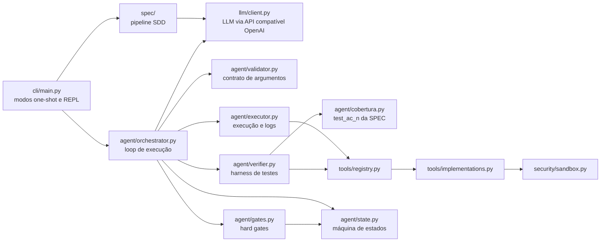
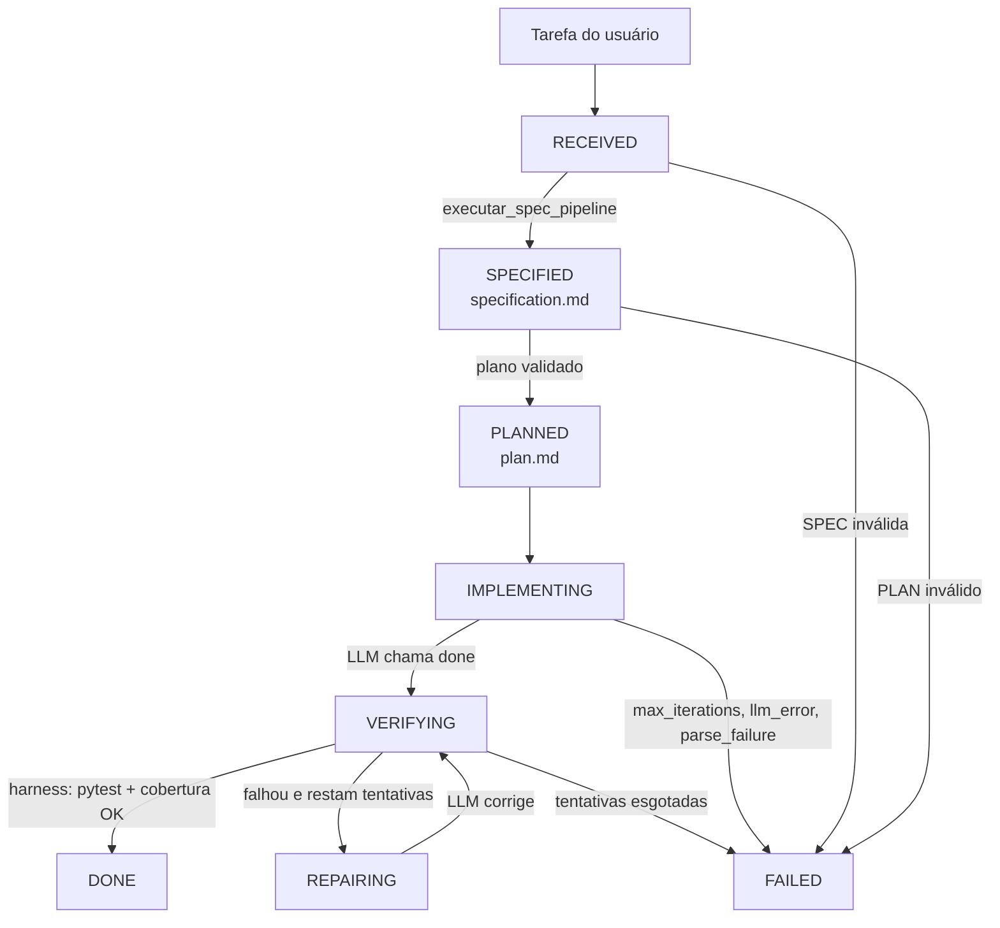

# Arquitetura do MiniCode

MiniCode é um agente autônomo de programação. Recebe uma tarefa em linguagem natural, gera uma especificação (SPEC) e um plano (PLAN) validados, implementa o código em um diretório de projeto e só encerra quando os testes exigidos pela SPEC existem e passam.

Assim o LLM propõe ações, o harness Python decide o que é permitido, executa as ferramentas e verifica o resultado. O modelo nunca executa testes diretamente.
---
## O. Decisões de Contrato

As decisões arquiteturais e de contrato adotadas para padronizar o comportamento do agente, cliente LLM e parsers estão registradas abaixo:

| Decisão | Contrato Atual | Justificativa |
| :--- | :--- | :--- |
| **Chave da ação** | `tool` (com `thought` e `args`) | Padronizado em todo o pipeline (`orchestrator`, `action_contract`, `action_parser`, `catalog`, prompts e logs). |
| **Posição de `thought`** | Primeiro campo do objeto JSON | O raciocínio é gerado antes da escolha da ferramenta e dos argumentos, melhorando a coerência do modelo. |
| **Retorno de `chat()`** | Sempre `LLMResponse` | Encapsula `.content`, `tool_calls`, `finish_reason`, latência e contagem de tokens; `FakeLLM`s nos testes seguem o mesmo contrato. |
| **Roteamento e modos do Cliente** | `LLMClient` com `AgentRoutingConfig` e `constrained_mode` | Suporta tanto execução monolítica quanto roteamento por papel (`ROLE_TOOL_SELECTION` / `ROLE_REPAIR`) e decodificação restrita (`v-a` a `v-d`). |
| **`run_tests` para a LLM** | Definido no catálogo com `so_harness=True`, omitido do prompt e bloqueado nos *gates* | Apenas o harness executa testes em `VERIFYING`; qualquer tentativa explícita do modelo sofre rejeição controlada. |
| **`replace_text`** | Implementado em `implementations.py`, registrado em `ToolRegistry` e ativo no `TOOL_CATALOG` | Mantém paridade total entre o catálogo exposto ao modelo e as ferramentas executáveis. |
| **Retry de formato** | Laço interno no cliente (`src/llm/retry.py`) antes de escalar ao orquestrador | Erros transitórios de formatação JSON são absorvidos pelo cliente; o orquestrador só contabiliza `MAX_PARSE_FAILURES` quando o retry interno se esgota. |
---
## 1. Princípios

| Princípio | Como é aplicado |
|---|---|
| O LLM propõe, o harness decide | Toda ação passa por validador e hard gates antes de executar |
| Verificação fora do LLM | `run_tests` é chamado só pelo harness, em `VERIFYING` |
| Especificação antes de código | Escrita de arquivos só é permitida depois de SPEC e PLAN validados |
| Cobertura exigida pela SPEC | `DONE` exige que cada `test_ac_n` listado na SPEC exista e passe |
| Estado explícito | Máquina de estados com tabela de transições e contadores de escrita e teste |

## 2. Componentes



| Pacote | Responsabilidade | Arquivos principais |
|---|---|---|
| `cli` | Entrada do usuário, flags, renderização de eventos | `main.py`, `renderer.py` |
| `spec` | Geração e validação de SPEC e PLAN, com retry | `pipeline.py`, `generator.py`, `prompts.py`, `validators.py`, `context.py`, `persistence.py`, `models.py` |
| `agent` | Loop, estado, gates, verificação e reparo | `orchestrator.py`, `state.py`, `gates.py`, `validator.py`, `executor.py`, `verifier.py`, `cobertura.py`, `lint_testes.py`, `repair_context.py`, `context_manager.py`, `schemas.py` |
| `tools` | Catálogo e ferramentas que o agente pode usar nos arquivos do projeto | `catalog.py`, `registry.py`, `implementations.py`, `base.py`, `truncate.py` |
| `llm` | Cliente da API, roteamento por papel, retry, parser/contrato de ações e métricas | `client.py`, `routing.py`, `retry.py`, `action_contract.py`, `action_parser.py`, `metrics.py`, `errors.py` |
| `security` | Confinamento de caminhos e validação de comandos | `sandbox.py`, `validator.py`, `errors.py` |
| `trace` | Logger e estado por execução (integrado ao fluxo/registro de execuções) | `logger.py`, `state.py` |
| raiz | Configuração por variáveis de ambiente | `config.py` |

## 3. Fluxo de execução



Em cada etapa:

1. **SPEC.** `coletar_contexto` lista o projeto e lê arquivos prioritários (README, `pyproject.toml`, testes, código) com orçamento de 12 000 caracteres. O LLM gera a SPEC, que é validada por regras estruturais (V1 a V7). Até 3 tentativas, com feedback dos erros.
2. **PLAN.** O LLM gera passos numerados. Cada passo deve citar ao menos um `AC-n`, sem buracos na numeração e sem `AC-n` inexistente (P1 a P5). Até 3 tentativas.
3. **IMPLEMENTING.** O LLM escolhe uma ação por turno (JSON com `tool` e `args`). O orquestrador valida, aplica gates, executa e devolve o resultado como observação.
4. **VERIFYING.** Ao receber `done`, o harness roda o teste configurado e verifica a cobertura da SPEC. Aprovado com teste verde após a última escrita, vai para `DONE`.
5. **REPAIRING.** Reprovado, o harness envia ao LLM a SPEC, o conteúdo atual dos arquivos tocados, a saída do pytest truncada e um resumo das últimas tentativas. Ao corrigir, volta para `VERIFYING`.

## 4. Máquina de estados

Tabela de transições definida em `agent/state.py` (`TRANSITIONS`):

| De | Para |
|---|---|
| RECEIVED | SPECIFIED, FAILED |
| SPECIFIED | PLANNED, FAILED |
| PLANNED | IMPLEMENTING, FAILED |
| IMPLEMENTING | VERIFYING, FAILED |
| VERIFYING | DONE, REPAIRING, FAILED |
| REPAIRING | VERIFYING, FAILED |
| DONE | (terminal) |
| FAILED | (terminal) |

Ao entrar em `REPAIRING`, o contador `repair_attempts` é incrementado. Se atingir `max_repair_attempts`, a máquina vai para `FAILED`.

Os contadores `sequence_counter`, `last_write_seq`, `last_test_seq` e `last_test_ok` garantem que `DONE` só seja aceito quando o último teste foi executado depois da última escrita e teve sucesso.

## 5. Hard gates

| Regra | Implementação | Momento |
|---|---|---|
| Escrita só em `IMPLEMENTING` ou `REPAIRING` | `AgentStateMachine.check_tool_permission` via `ExecutionGateManager.check_gate` (e `ActionValidator.validate`) | Antes de executar `write_file`, `append_file` ou `replace_text` |
| `tests/` imutável durante o reparo | `ActionValidator.validate` (`_is_under_tests_dir`) | Antes de executar ferramentas de escrita em `REPAIRING` |
| `DONE` só com teste verde após a última escrita | `AgentStateMachine.validate_done_gate` (`last_test_seq > last_write_seq` e `last_test_ok`) | Ao verificar `done` |
| `run_tests` é exclusivo do harness | Orquestrador e `ExecutionGateManager` rejeitam a chamada do LLM | Antes de executar |
| Argumentos e limites dentro do contrato | `ActionValidator.validate` (schema, tipos e limite de 500 000 caracteres) | Antes dos gates |
| Caminhos confinados ao projeto e sem `.minicode/` | `security/sandbox.py` (`resolve_in_root`) | Em toda ferramenta de arquivo |
| Todo `test_ac_n` da SPEC deve existir e passar | `cobertura.testes_ausentes` dentro de `HarnessVerifier.run_verification` | Em `VERIFYING` |
| Comando de teste customizado validado | `CommandValidator` no `--test-cmd` | Na inicialização da CLI |
| Limite de janela de contexto | `estimar_tokens` contra `0.8 * (MAX_MODEL_LEN - T_RESP_RESERVE)` | Antes de chamar o LLM |

Durante `IMPLEMENTING`, o agente pode criar e ajustar testes, desde que todos os `test_ac_n` exigidos pela SPEC continuem presentes (checagem por nome do teste). Já em `REPAIRING`, qualquer escrita em `tests/` é bloqueada para impedir que o modelo altere os testes para mascarar falhas de implementação. Ver seção 12.

---
## 6. Ferramentas disponíveis ao LLM

| Ferramenta | Argumentos | Efeito | Altera arquivos |
|---|---|---|---|
| `list_files` | `path`, `max_entries` | Lista arquivos e diretórios | Não |
| `read_file` | `path`, `start_line`, `end_line` | Lê texto com numeração de linhas (máx. 4 000 caracteres na saída) | Não |
| `write_file` | `path`, `content` | Cria ou substitui o arquivo inteiro (máx. 500 000 caracteres) | Sim |
| `append_file` | `path`, `content` | Acrescenta ao final, criando o arquivo se necessário | Sim |
| `replace_text` | `path`, `old_str`, `new_str` | Substitui um trecho que deve ocorrer exatamente uma vez | Sim |
| `run_tests` | `path`, `args`, `command` | Executa pytest (`so_harness=True`: omitida do prompt e bloqueada ao LLM) | Não |
| `done` | — | Interceptada pelo orquestrador para encerrar a implementação e disparar `VERIFYING` | Não |

Todas as ferramentas de arquivo passam por `resolve_in_root`. Erros são convertidos em `ToolResult(ok=False, error=...)` por `@safe_tool`, e o `ToolExecutor` propaga `ok=False` ao orquestrador.

## 7. Harness de verificação

`HarnessVerifier.run_verification` faz duas checagens:

1. **Execução.** Roda o comando de teste (padrão `pytest -x --tb=short -q`). Aprovado somente com código de saída `0`, sem a string `0 passed` e sem `no tests ran`.
2. **Cobertura.** `testes_ausentes` lê a seção `## Tests` da `specification.md`, coleta os testes com `pytest --collect-only -q` e lista os `test_ac_n` que não foram encontrados. Qualquer ausência reprova a verificação. A mensagem `COBERTURA INCOMPLETA` é anexada no fim da saída, para não ser cortada pelo truncamento.

A verificação só é aprovada quando as duas checagens passam.

## 8. Reparo

Quando a verificação falha, `RepairContextBuilder` monta o prompt com:

- a SPEC completa;
- o conteúdo atual dos arquivos tocados, lido do disco;
- a saída do pytest, truncada a 1 500 tokens estimados;
- as três últimas tentativas, com erro resumido e arquivos tocados;
- um aviso quando o mesmo erro se repete, identificado por assinatura (hash do resumo do erro).

O LLM recebe a instrução de corrigir a causa raiz e de manter os `test_ac_n` exigidos.

## 9. Orçamento de contexto e truncamento

| Mecanismo | Regra | Valor padrão |
|---|---|---|
| Estimativa de tokens | caracteres ÷ 3,5 | — |
| Limite do prompt | 0,8 × (`MAX_MODEL_LEN` − `T_RESP_RESERVE`) | 0,8 × (8 192 − 1 024) ≈ 5 734 tokens |
| Overflow | Prompt acima do limite leva a `FAILED` com `context_overflow` | — |
| Saída do pytest | Mantém o bloco `short test summary info` e as últimas linhas | 1 500 tokens no reparo |
| Saída de ferramentas | Corte do meio com marcador de quantos caracteres foram omitidos | 4 000 caracteres |
| Histórico | Só as últimas 3 tentativas aparecem no prompt | 3 |

## 10. Respostas do LLM e chamadas à API

`LLMClient` usa a API compatível com OpenAI. O modo padrão é `json` (com suporte opcional a `native` via `tool_choice: auto`, além de decodificação restrita via `MINICODE_CONSTRAINED_MODE` em `v-a` a `v-d` e roteamento híbrido por papel entre `ROLE_TOOL_SELECTION` e `ROLE_REPAIR`). No modo `json`, as ferramentas são descritas no prompt e o modelo responde com um objeto JSON (`{"thought": ..., "tool": ..., "args": ...}`).

O contrato e o parse das ações são unificados por `interpretar_acao` (`llm/action_contract.py`) e `parse_acao_json` (`llm/action_parser.py`), que extraem o JSON de blocos ```` ```json ```` ou do primeiro objeto `{...}` balanceado e validam o envelope:
- Quando `tools_schema` é passado ao `LLMClient` no modo `json`, o próprio cliente valida o envelope e executa um laço interno de reformulação antes de retornar `LLMResponse` (ou levantar `LLMFormatError`).
- No orquestrador, falhas estruturais que escapam do cliente incrementam o contador de parse; ao atingir `MAX_PARSE_FAILURES`, a execução encerra em `FAILED` com `parse_failure`.

Chamadas à API passam por `executar_com_retry` (`llm/retry.py`):

| Erro | Comportamento |
|---|---|
| Timeout | Retry com backoff exponencial e jitter |
| Rate limit (429) | Retry com backoff, multiplicado por 2 |
| Erro 5xx | Retry com backoff |
| Erro 4xx (exceto 429) | Sem retry, levanta `LLMBadRequestError` |

---
## 11. Eventos para a interface

A execução emite eventos para o renderer. São o que o vídeo mostra:

| Evento | Quando | Campos principais |
|---|---|---|
| `task_received` | Início da execução | `task` |
| `state_changed` | Cada transição de estado | `old`, `new` |
| `spec_ready` | SPEC validada | `path`, `content` |
| `plan_ready` | PLAN validado | `path`, `content` |
| `action` | Cada ação do LLM, com ou sem erro | `tool`, `args`, `error` |
| `tests_run` | Cada verificação do harness | `command`, `passed`, `output` |
| `repair_attempt` | Entrada em REPAIRING | `k`, `K` |
| `run_finished` | Fim da execução | `final_state`, `success` |

Os eventos são emitidos pelo orquestrador (`on_event`) e pela CLI (`run_task`). `JsonRenderer` ignora os intermediários e imprime só o resultado final.

## 12. Rastreabilidade e estado atual

Cada execução do agente é auditável e persistida em `<projeto>/.minicode/`, combinando atalhos para a última execução na raiz e histórico isolado por *run* via pacote `trace` (`RunLogger` e `RunState`):

- `.minicode/latest`: identifica o ID (`<timestamp-UTC>`) da execução mais recente.
- `.minicode/actions.jsonl` e `.minicode/state.json`: refletem a execução atual/última na raiz (com escrita atômica via `.tmp` + `rename` no `state.json`).
- `.minicode/runs/<timestamp-UTC>/`: diretório isolado criado por execução contendo o seu próprio `actions.jsonl` (uma linha por *tool call* com argumentos sanitizados) e `state.json` (estado final consolidado com transições, tokens, tentativas de reparo, arquivos alterados e tempo decorrido).

## 13. Segurança

- **Confinamento de caminhos.** `resolve_in_root` resolve o caminho, bloqueia `..`, caminhos absolutos fora do projeto, byte nulo e acesso a `.minicode/`.
- **Comandos.** `CommandValidator` aplica denylist (sudo, shutdown, curl pipe para shell, etc.) e allowlist de executáveis (`pytest`, `python`, `git`, `ls`, `cat`, `echo`). Subshell, crase e quebra de linha são rejeitados. `git` aceita só `diff`, `status` e `log`. O `--test-cmd` é validado na CLI.
- **Execução.** Comandos rodam com `subprocess.run` em lista, sem `shell=True`, com timeout de `COMMAND_TIMEOUT` segundos.
- **Limite real.** O código gerado pelo LLM é executado pelo pytest dentro do projeto, com as permissões do usuário. Não há isolamento de sistema operacional. Para tarefas não confiáveis, execute em contêiner ou máquina virtual.

## 14. Configuração

| Variável / flag | Padrão | Uso |
|---|---|---|
| `MINICODE_API_KEY` | obrigatória | Chave da API |
| `MINICODE_API_BASE` | obrigatória | URL base compatível com OpenAI |
| `MINICODE_MODEL_NAME` | `Qwen/Qwen2.5-14B-Instruct-AWQ` | Modelo principal |
| `MINICODE_MAX_ITERATIONS` / `--max-iterations` | 15 | Iterações do loop principal |
| `MINICODE_MAX_REPAIR_ATTEMPTS` / `--max-repair-attempts` | 2 | Tentativas de reparo |
| `MINICODE_MAX_PARSE_FAILURES` | 3 | Respostas inválidas consecutivas antes de falhar |
| `MINICODE_COMMAND_TIMEOUT` | 60 | Timeout de comandos, em segundos |
| `MINICODE_MAX_MODEL_LEN` | 8 192 | Janela de contexto do modelo |
| `MINICODE_T_RESP_RESERVE` | 1 024 | Tokens reservados para a resposta |
| `MINICODE_CONSTRAINED_MODE` | `none` | Modo de decodificação restrita (`none`, `v-a`, `v-b`, `v-c`, `v-d`) |
| `--test-cmd` | `pytest -x --tb=short -q` | Comando de verificação |
| `--project` | `.` | Diretório do projeto |

Modos de execução: `minicode "tarefa" --project <dir>` (one-shot), `minicode --project <dir>` (REPL, com `/help` e `/exit`). Saídas: padrão legível, `--verbose`, `--quiet`, `--json` e `--no-color`.

## 15. Estrutura do repositório

```text
MiniCode/
├── pyproject.toml          # empacotamento e configuração do pytest
├── docs/
│   └── architecture.md     # este documento
├── src/
│   ├── config.py
│   ├── cli/                # main.py, renderer.py
│   ├── spec/               # pipeline, generator, prompts, validators, context, persistence, models
│   ├── agent/              # orchestrator, state, gates, validator, executor, verifier, cobertura, lint_testes, repair_context, context_manager, schemas
│   ├── tools/              # catalog, registry, implementations, base, sandbox, truncate
│   ├── llm/                # client, routing, retry, action_contract, action_parser, metrics, errors
│   ├── security/           # sandbox, validator, errors
│   ├── trace/              # logger, state (integrado ao fluxo em .minicode/)
│   ├── dataset/            # build_sft_dataset, target_validator (preparação de dados SFT)
│   └── eval/               # eval_level1 (avaliação offline Nível 1)
├── scripts/                # coleta de corpus, filtragem, splits, replay e avaliação
├── notebooks/              # train.ipynb (fine-tuning LoRA)
└── tests/                  # testes unitários, integração e ciclos completos com LLM simulado
```

Execução de uma tarefa cria, no projeto alvo: `specification.md`, `plan.md`, o código e os testes, e `.minicode/`.

## 16. Decisões de projeto

| Decisão | Motivo |
|---|---|
| Modo JSON em vez de tool calling nativo | O servidor vLLM atual rejeita `tool_choice: auto` (sem `--enable-auto-tool-choice`) |
| Harness roda os testes | Evita que o LLM declare sucesso sem executar a verificação |
| Cobertura por nome de teste | Garante que a SPEC foi atendida sem depender de interpretação do LLM |
| `write_file` substitui; `append_file` acrescenta | Acrescentar evita regravar testes já existentes, mas `write_file` continua disponível |
| PLAN sem passo de `run_tests` | A verificação pertence ao harness, não ao plano |
| Validação estrutural da SPEC e do PLAN | Garante formato previsível para o restante do pipeline |
| Remoção de preâmbulo antes da validação | O LLM costuma escrever uma frase antes do documento |

## 17. Limitações conhecidas

- **Testes podem ser enfraquecidos.** A cobertura confere o nome do teste, não se ele verifica o AC. Um teste pode ser trocado por um `assert True` com o mesmo nome. Plano a ser implementado: exigir ao menos um `assert` ou `pytest.raises` por teste.
- **Sobrescrita de arquivos.** `write_file` substitui o arquivo inteiro. Em execuções com muitos passos, o LLM pode apagar trabalho anterior.
- **Tipos aceitos.** A validação de tipo em exemplos usa `isinstance(x, int)`, que aceita `bool`. A SPEC não especifica esse caso.
- **Sem isolamento de sistema operacional.** Ver seção 13.
- **Um único formato de teste.** O harness só conhece pytest.

## 18. Arquitetura da Parte 2 — Especialização, Roteamento Híbrido e Avaliação

A Parte 2 introduziu a especialização supervisionada (SFT + QLoRA) de um modelo compacto (`Qwen/Qwen2.5-Coder-1.5B-Instruct`) e sua integração ao loop do agente:

1. **Roteamento Híbrido por Papel (`src/llm/routing.py`):**
   - `ROLE_TOOL_SELECTION`: direcionado ao modelo especializado leve (`Qwen/Qwen2.5-Coder-1.5B-Instruct` + adaptador LoRA) com `minicode-prompt-v2` (`catalogo_enxuto=True`).
   - `ROLE_REPAIR`: mantido no modelo professor de maior capacidade (`Qwen/Qwen2.5-14B-Instruct-AWQ`) para diagnóstico complexo de falhas de `pytest`.
2. **Alinhamento Treino = Inferência (`docs/g3_prompt_and_scope_decision.md`):**
   - O builder SFT (`src/dataset/build_sft_dataset.py`), o notebook de treino (`notebooks/train.ipynb`) e o orquestrador (`src/agent/orchestrator.py`) compartilham exatamente o mesmo system prompt (`minicode-prompt-v2`), eliminando *distribution shift* de esquema JSON.
3. **Pipeline Reprodutível de Dados e Avaliação:**
   - `scripts/collect_corpus.py`: coleta trajetórias completas (`actions.jsonl`, `state.json`, `metrics.json`) em `corpus_tasks/`.
   - `scripts/filter_and_label.py`: aplica filtros `F1`–`F6` e gera amostra de auditoria (`audit_sample_50.jsonl`).
   - `scripts/split_dataset.py`: impõe divisão sem vazamento por `task_id` via `split_manifest.json` congelado.
   - `scripts/eval_baselines.py` e `src/eval/eval_level1.py`: avaliam `Acc_tool`, `JSON_valid`, `Exact_action`, `F1_macro` e intervalos de confiança de 95% via *bootstrap* pareado por `run_id` (10.000 reamostragens), gerando `baselines_report.json`, `eval_g8_report.json` e `error_analysis_g8.json`.
4. **Serving Local In-Process (`src/llm/local_peft_handler.py`) e Métrica $\rho$:** Executa `Qwen/Qwen2.5-Coder-1.5B-Instruct` (base ou +LoRA) via `role_chat_handlers` e contabiliza $\rho = N_{\text{tool\_selection}} / (N_{\text{tool\_selection}} + N_{\text{repair}})$ em `src/llm/routing.py` e `AgentOrchestrator`.
5. **Ablações (`no_repair` / `no_spec`) e Runner E2E (`scripts/run_e2e_hybrid.py`):** `AgentOrchestrator(repair_enabled=False)` encerra em `FAILED` (`failure_reason="repair_disabled"`) na primeira falha de `VERIFYING`, enquanto o modo sem SPEC (`no_spec`) isola o impacto do pipeline SDD; `run_e2e_hybrid.py` persiste `experiments/e2e_hybrid/runs.jsonl` e `summary_report.json`[cite: 1, 4, 5].